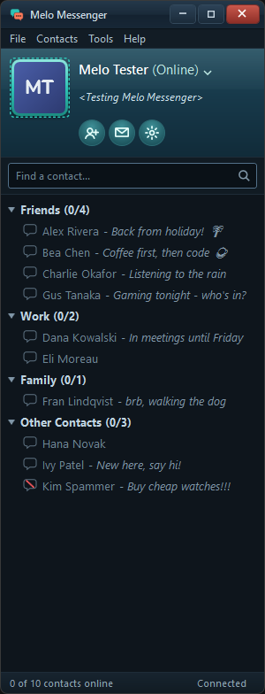
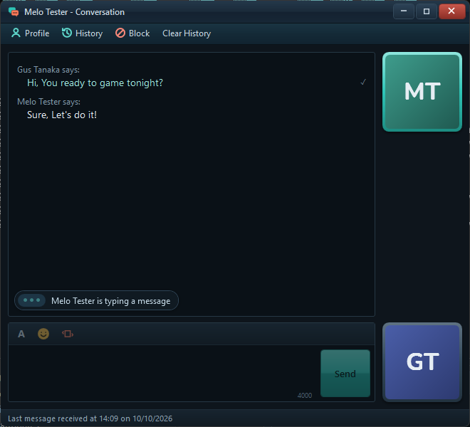
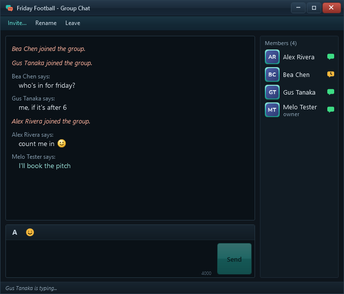
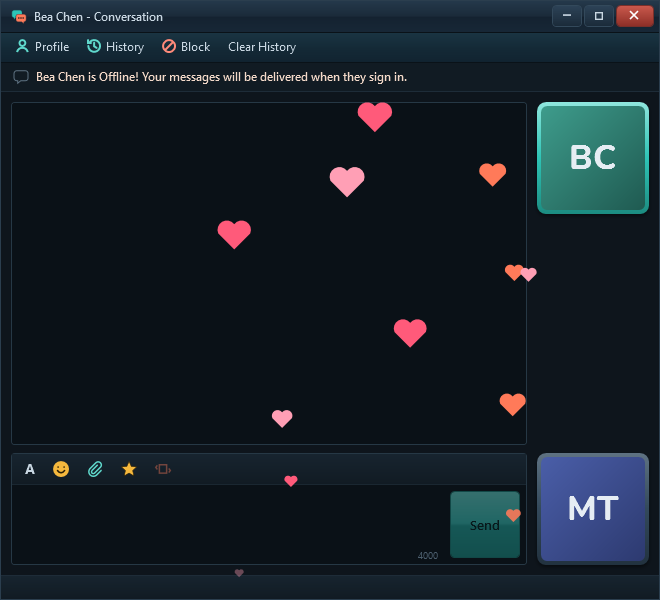
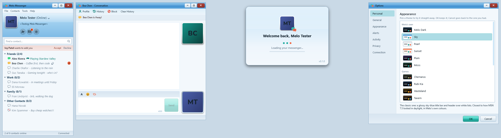
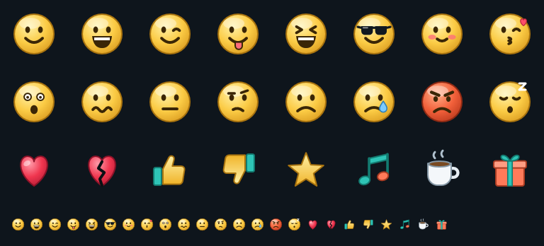

<h1 align="center">Melo Messenger</h1>

A messenger for Windows, made the way messengers used to be.

Melo Messenger is a chat program for your desktop, inspired by the instant messengers of the 2000s: a small contact list in the corner of your screen, a window for each conversation, nudges, winks, and a personal message under your name. It's free, has no adverts, and is made by one person as a hobby.

It's a **beta**: it works, and it's still being improved.

| | |
|:---:|:---:|
|  |  |
| Your contacts, in groups, with their status and personal message | A window for each conversation |

## What you can do

- **Chat** one to one or in **group chats**, with emoticons, text formatting and your own custom emoticons
- **Voice and video calls**, with up to five people
- **Share your screen**, or a single window, at up to 4K and 60 frames a second
- **Send files and pictures** straight from your PC to your friend's; they're never stored on a server
- **Nudge** a friend to shake their window, or send a **wink** that plays across the chat
- Set your **status**, a personal message, a display picture, and show what you're playing or listening to
- Choose from **eighteen themes**, light and dark
- Look back through your **message history** and search it

| | |
|:---:|:---:|
|  |  |
| Group chats | Winks |

One of the eighteen themes: Sky

## Download

Get the latest **MeloMessenger-Setup** from the [Releases page](https://github.com/melomessenger-app/Melo-Messenger-Updates/releases/latest) and run it.

- Needs Windows 10 or Windows 11 (64-bit). Nothing else has to be installed first.
- Windows may show a blue **"Windows protected your PC"** box, because Melo is new and not yet signed. Click **More info**, then **Run anyway**.
- Choose where to install it, create an account, and add your friends by their e-mail address.

Melo keeps itself up to date: when a new version is ready it offers to restart, and nothing changes until you agree.

To remove it, use *Settings → Apps → Installed apps → Melo Messenger → Uninstall*.

---

Melo Messenger is an original, independent project. It is not affiliated with Microsoft, MSN or Windows Live Messenger.
